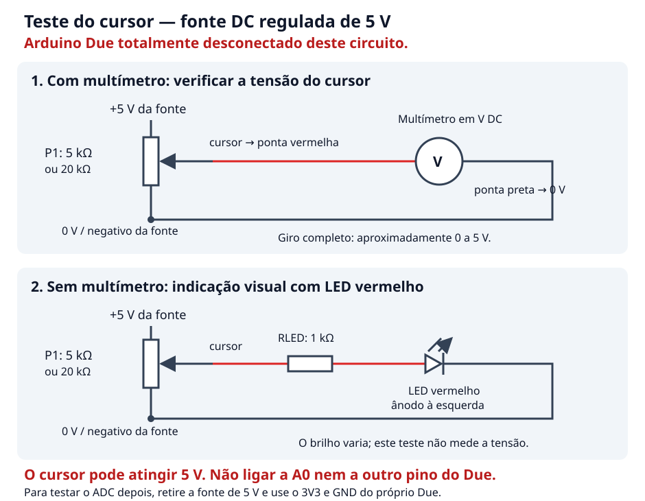

# Validar o cursor do potenciômetro com uma fonte de 5 V

Este teste usa somente o potenciômetro, uma **fonte DC regulada de 5 V** e um
multímetro ou um LED com resistor. **O Arduino Due fica desconectado do
circuito**, pois o cursor poderá atingir 5 V. Não ligue o cursor a A0 nem a
outro pino do Due: suas entradas não toleram 5 V.
[Limites elétricos oficiais do Due](https://store.arduino.cc/products/arduino-due).



## 1. Identificar os terminais, com a fonte desligada

Se tiver multímetro, selecione resistência (Ω) e meça os três pares de
terminais enquanto gira o eixo:

- O par cuja resistência permanece aproximadamente **5 kΩ** é formado pelos
  dois extremos. Para o potenciômetro de 20 kΩ, esse par mede aproximadamente
  20 kΩ.
- O terceiro terminal é o **cursor**. A resistência entre ele e cada extremo
  varia com a posição do eixo, aproximadamente entre zero e o valor total.

O cursor costuma ser o terminal central, mas confirme o modelo. Nunca faça a
medição em Ω com a fonte conectada ou energizada.

## 2. Ligar diretamente à fonte de 5 V

Com a fonte desligada, faça estas conexões:

```text
+5 V da fonte ── extremo A do potenciômetro
 0 V da fonte ── extremo B do potenciômetro

Cursor ── ponta vermelha do multímetro
  0 V ── ponta preta do multímetro
```

Selecione **tensão contínua (V DC)**, numa faixa que comporte 5 V, como 20 V
nos multímetros com escala manual. A ponta preta fica no conector **COM** e
a vermelha no conector **V/Ω**, não no conector de corrente A/mA.

Ligue a fonte e gire lentamente o eixo:

| Posição elétrica do cursor | Tensão esperada |
|---|---:|
| Junto ao extremo ligado a 0 V | Próxima de 0 V |
| Meio do percurso, se o potenciômetro for linear | Aproximadamente 2,5 V |
| Junto ao extremo ligado a +5 V | Próxima de 5 V |

A tensão real depende da fonte, dos contatos e das tolerâncias. Um
potenciômetro logarítmico também percorre a faixa, mas o meio do giro não
corresponde necessariamente a 2,5 V. Trocar os dois extremos inverte o sentido
do ajuste.

Sem carga no cursor, o potenciômetro de 5 kΩ consome aproximadamente **1 mA**
e dissipa **5 mW**; o de 20 kΩ consome 0,25 mA e dissipa 1,25 mW. Não é
necessário um resistor adicional entre a fonte e os extremos para este teste.

## 3. Alternativa sem multímetro: LED e resistor

Mantenha os extremos ligados à fonte e monte:

```text
Cursor ── resistor 1 kΩ, ¼ W ── ânodo do LED vermelho
                               cátodo do LED ── 0 V da fonte
```

O ânodo normalmente é a perna longa; o cátodo costuma ser a perna curta e o
lado achatado do encapsulamento. O **resistor de 1 kΩ é obrigatório** neste
ramo do LED.

Ao girar, o LED deve passar de apagado a aceso, com variação de brilho. Ele
só começa a conduzir acima de sua tensão de funcionamento e carrega o
cursor, portanto esta opção é uma indicação visual, não uma medição de
tensão nem uma avaliação de linearidade. Desligue a fonte antes de mudar
qualquer conexão.

## 4. Voltar ao teste do ADC do Due

Desligue e retire a fonte de 5 V. Depois use a montagem anterior:

```text
Due 3V3 ── extremo A
Due GND ── extremo B
Cursor  ── resistor 1 kΩ ── Due A0
```

O resistor em série com A0 não converte 5 V em 3,3 V. A montagem completa do
teste do ADC está no
[documento 034](../../docs/034_validacao-adc-arduino-due.md).
