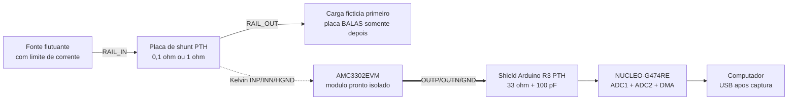

# Diagrama de montagem do medidor de corrente em placas padronizadas

Revisao: 2026-09-03

Status: diagrama eletrico de laboratorio definido, ainda nao montado nem
validado fisicamente. Validar primeiro com a carga ficticia. Nao conectar uma
placa BALAS enquanto os criterios da secao 9 nao forem aprovados.

Este documento transforma o projeto de
[025_projeto-medidor-corrente-dc-instantanea.md](025_projeto-medidor-corrente-dc-instantanea.md)
em uma montagem possivel com solda manual PTH. A lista de compras correspondente
esta em [026_lista-compras-medidor-corrente-dc.md](026_lista-compras-medidor-corrente-dc.md).

## 1. Decisao de montagem

A primeira versao nao usara uma PCB personalizada nem o `AMC3302` SMD avulso.
Ela sera composta por blocos prontos e placas de passo padrao:

1. `NUCLEO-G474RE`, pronta;
2. `AMC3302EVM`, pronta e ja testada pela fabricante como placa de avaliacao;
3. shield de prototipagem no padrao mecanico Arduino Uno R3, passo `2,54 mm`, com apenas
   bornes, resistores e capacitores PTH;
4. duas placas de shunt PTH intercambiaveis, uma de `0,1 ohm` e outra de
   `1 ohm`;
5. placa universal PTH separada para a carga ficticia de validacao.

O `AMC3302EVM` contem componentes SMD, mas chega montado. Nao ha solda SMD a ser
feita no laboratorio. A TI documenta bornes para entrada e saida, faixa de
entrada de `+/-50 mV`, ganho nominal `41` e isolamento integrado.

## 2. Visao geral



A linha tracejada e a leitura Kelvin do shunt; ela nao conduz a corrente da
carga. A barreira galvanica esta dentro do `AMC3302EVM`. O computador e a
NUCLEO ficam do lado isolado.

## 3. Diagrama eletrico do canal de corrente

```text
                           PLACA DE SHUNT PTH

       JSH1.1 RAIL_IN o--------C  RSHUNT  C--------o JSH1.2 RAIL_OUT
                                S         S
                                |         |
                                |         +-------------o JSH2.2 SENSE_OUT
                                +-----------------------o JSH2.1 SENSE_IN

       C = terminal de corrente       S = terminal Kelvin de sense


       AMC3302EVM, SEM ALTERAR A PLACA

       JSH2.1 SENSE_IN  -------------------------- J2.1 INP
       JSH2.2 SENSE_OUT -------------------------- J2.2 INN
       JSH2.2 SENSE_OUT -------------------------- J2.3 HGND

       NUCLEO +5V -------------------------------- J1.1 VDD
       NUCLEO GND_MEDIDOR ------------------------ J1.2 GND

       J3.2 OUTP ---- R1 33 ohm ----+------------- A0 / PA0 / ADC1_IN1
                                     |
                                    C1 100 pF C0G, PTH
                                     |
       J3.3 GND ---------------------+------------- GND_MEDIDOR

       J3.1 OUTN ---- R2 33 ohm ----+------------- A1 / PA1 / ADC2_IN2
                                     |
                                    C2 100 pF C0G, PTH
                                     |
       J3.3 GND ---------------------+------------- GND_MEDIDOR
```

Conexoes confirmadas no material oficial:

- no `AMC3302EVM`, `J2.1 = INP`, `J2.2 = INN`, `J2.3 = HGND`,
  `J3.1 = OUTN`, `J3.2 = OUTP`, `J3.3 = GND`, `J1.1 = VDD` e
  `J1.2 = GND`;
- na `NUCLEO-G474RE`, o header Arduino expoe `A0 = PA0 = ADC12_IN1` e
  `A1 = PA1 = ADC12_IN2`;
- o firmware deve configurar `PA0` no `ADC1`, `PA1` no `ADC2`, modo regular
  simultaneo, mesmo trigger de timer e DMA combinado de `32 bits`.

Os fios `OUTP`, `OUTN` e `GND_MEDIDOR` formam um trio curto, de no maximo
`10 cm`. Torcer `OUTP` com um retorno GND e `OUTN` com outro retorno GND. Os
resistores e capacitores devem ficar no shield, junto aos pinos `A0/A1`.

## 4. Placas de shunt PTH

Montar duas placas fisicamente separadas. Nao usar chave para trocar a faixa.

| Placa | RSHUNT | Componente PTH recomendado | Faixa nominal | Identificacao |
| --- | ---: | --- | ---: | --- |
| `HIGH` | `0,100 ohm` | Caddock `SR10-0.10-1%`, quatro terminais Kelvin | ate `400 mA` | etiqueta vermelha |
| `LOW` | `1,000 ohm` | Caddock `SR10-1.00-1%`, quatro terminais Kelvin | ate `40 mA` | etiqueta azul |

Os dois resistores sao PTH, nao indutivos, `1 W`, `1%` e possuem quatro
terminais. A tolerancia de `1%` nao e um impedimento: o valor efetivo de cada
placa sera obtido na calibracao estatica e salvo no firmware. Nessa aplicacao,
a dissipacao maxima nominal e apenas `16 mW` na faixa HIGH e `1,6 mW` na LOW,
portanto o autoaquecimento do shunt e pequeno.

Layout em placa universal ilhada de `2,54 mm`:

```text
     BORNE 2P       RSHUNT CADDOCK 4 TERMINAIS       BORNE 2P
   +-----------+       C  S   S  C                  +-----------+
   | RAIL_IN o |=======o  o   o  o==================| o RAIL_OUT|
   |       NC o|                                      | o NC      |
   +-----------+                                      +-----------+
                         |   |
                         |   +-------- SENSE_OUT ----+
                         +------------ SENSE_IN -----+  BORNE 2P
```

As trilhas/fios grossos (`AWG 22`) vao somente aos terminais `C`. Os fios de
sense (`AWG 26` ou `AWG 24`) saem somente dos terminais `S` e chegam ao `J2` do
EVM. Nao unir `C` e `S` por uma trilha distante do componente.

## 5. Shield padrao Arduino R3 sobre a NUCLEO

A `NUCLEO-G474RE` possui conector de expansao Arduino Uno V3. Usar um
proto-shield R3 com grade `0,1 pol / 2,54 mm` e headers empilhaveis. A montagem
minima do shield tem apenas:

`Arduino Uno V3`, aqui, e apenas o nome do padrao mecanico dos conectores; nao
e a identificacao da placa Arduino considerada anteriormente para aquisicao.

- borne PTH de tres vias: `OUTP`, `OUTN`, `GND_MEDIDOR`;
- `R1` e `R2`: `33 ohm`, axial, `1%`;
- `C1` e `C2`: `100 pF`, radial PTH, C0G/NP0;
- borne PTH de duas vias: `+5V` e `GND_MEDIDOR` para alimentar `J1` do EVM;
- ponto de teste PTH em `A0`, `A1`, `5V` e `GND`.

Nao instalar o `AMC3302EVM` sobre a NUCLEO. Prende-lo na mesma base isolante
com espacadores de nylon e usar os bornes existentes. Isso evita peso mecanico
sobre os headers e preserva a separacao entre os lados do EVM.

## 6. Carga ficticia PTH para validacao

Esta placa nunca permanece conectada quando uma placa BALAS esta em uso. Na
validacao, compartilhar `GND_TESTE` com a NUCLEO e permitido porque nao existe
DUT a proteger. O isolamento do canal analogico continua sendo conferido
separadamente com o multimetro.

```text
                         RBASE 330 ohm / 0,25 W
       RAIL_OUT o----------/\/\/\/\/--------------------o GND_TESTE
             |
             |           RSTEP1 120 ohm / 0,5 W
             +-------------/\/\/\/\/----+---- D Q1 FQP30N06L
                                         |         S ----o GND_TESTE
                                         +-- nao ligar ao gate
             |
             |           RSTEP2 22 ohm / 2 W
             +-------------/\/\/\/\/----+---- D Q2 FQP30N06L
                                                   S ----o GND_TESTE

       GERADOR PTH DE GATE, U1 = SN74HCT14N, PDIP-14, VCC = 5 V

       NUCLEO D6 ---- U1A inversor ---- U1B inversor ---- 100 ohm ---- G Q1
                                                                    |
                                                                  100 kohm
                                                                    |
       NUCLEO D7 ---- U1C inversor ---- U1D inversor ---- 100 ohm ---- G Q2
                                                                    |
                                                                  100 kohm
                                                                    |
       NUCLEO GND ---------------------------------------------- GND_TESTE
       NUCLEO +5V ---------------- U1 pino 14
       NUCLEO GND ---------------- U1 pino 7
       100 nF PTH entre U1 pinos 14 e 7, junto ao CI
```

Os dois inversores em serie por canal preservam a polaridade. O `HCT14`
reconhece o nivel alto de `3,3 V` da NUCLEO e entrega aproximadamente `5 V` ao
gate. O `FQP30N06L` tem encapsulamento `TO-220` e resistencia de conducao
especificada com `VGS = 5 V`.

Pinagem exata da carga:

| Componente | Pino | Ligacao |
| --- | ---: | --- |
| `SN74HCT14N` | 14 | `+5V` da NUCLEO |
| `SN74HCT14N` | 7 | `GND_TESTE` |
| `SN74HCT14N` | 1 -> 2 -> 3 -> 4 | `D6 -> U1A -> U1B -> Rgate Q1` |
| `SN74HCT14N` | 5 -> 6 -> 9 -> 8 | `D7 -> U1C -> U1D -> Rgate Q2` |
| `SN74HCT14N` | entradas 11 e 13 | ligar ao `GND_TESTE`; deixar saidas 10 e 12 sem conexao |
| `FQP30N06L`, olhando a face escrita | 1 | gate, vindo do resistor de `100 ohm` |
| `FQP30N06L`, olhando a face escrita | 2 | dreno, vindo do resistor de carga |
| `FQP30N06L`, olhando a face escrita | 3 | source, ligado ao `GND_TESTE` |

Conferir a pinagem novamente nos datasheets das pecas recebidas antes de
soldar; substitutos com outro MPN podem ter pinagem diferente.

No desenho, a juncao do resistor de carga deve ir somente ao dreno do MOSFET;
nao deve ser unida ao gate. A observacao explicita evita um erro comum ao
transferir o diagrama para placa universal.

## 7. Marcador optico opcional

O primeiro firmware deve oferecer trigger por limiar de corrente. Assim, o
medidor funciona sem qualquer fio GPIO adicional na placa BALAS.

Se for necessario marcar exatamente o inicio e o fim de `Invoke()`, adicionar
depois um `6N137` em encapsulamento `DIP-8` no proto-shield. Ele e um
optoacoplador de `10 MBd`; o atraso maximo de propagacao especificado para a
familia e da ordem de `100 ns`, bem abaixo da resposta analogica do AMC3302.

Esse circuito e opcional porque o LED do opto exige corrente do GPIO e pode
alterar o consumo observado. Quando usado, a corrente do LED deve ser medida e
subtraida, ou o resistor/LED deve ser alimentado antes do shunt com um GPIO em
open-drain e uma analise especifica de sequenciamento. Nao ligar o opto nas
placas antes dessa revisao. Para o primeiro prototipo, use o trigger de corrente.

## 8. Canal de tensao e energia

A versao minima mede corrente dinamica e registra a tensao do rail com o
multimetro antes e depois da captura. Se a variacao for pequena, usar:

```text
E_aproximada = Vrail_medio * soma(I[k] * dt)
```

Isso atende a comparacao inicial de energia com muito menos hardware. Registrar
a tensao inicial, final e a hipotese de rail constante no CSV.

Se a tensao variar mais que `1%` durante o ensaio, adicionar na segunda etapa
um `AMC3330EVM` pronto e um divisor PTH. Nao montar o `AMC3330` SMD avulso. O
diagrama do canal opcional permanece na secao 6 do documento 025.

## 9. Sequencia obrigatoria de validacao

1. Inspecionar todas as soldas PTH com lupa e limpar residuos.
2. Sem energia, conferir continuidade conforme a tabela da secao 3.
3. Confirmar circuito aberto entre `GND_MEDIDOR` e qualquer borne `J2` do
   `AMC3302EVM`; usar escala alta e aguardar estabilizacao da leitura.
4. Instalar somente o shunt `LOW`, carga `RBASE` e fonte em `3,3 V` limitada a
   `20 mA`.
5. Energizar a NUCLEO e o EVM; confirmar que `OUTP` e `OUTN` permanecem entre
   `0 V` e `3,3 V` antes de conectar `A0/A1`.
6. Conectar `A0/A1`, executar `ZERO` e comparar a corrente com o multimetro.
7. Testar `RSTEP1` na faixa LOW.
8. Desligar tudo, trocar para o shunt HIGH, limitar a fonte a `250 mA` e testar
   `RSTEP1` e `RSTEP2`.
9. Executar pulsos de `100 us`, `10 us`, `5 us`, `2 us` e `1 us`, nessa ordem.
10. Aprovar pulsos de `5 us` antes de fabricar qualquer chicote para as placas.

Durante toda a validacao, a fonte da carga e a unica fonte ligada a
`RAIL_IN`. Nao conectar USB, debugger ou outra alimentacao a carga ficticia.

## 10. Pinagem resumida para montagem

| Origem | Destino | Tipo de fio | Observacao |
| --- | --- | --- | --- |
| fonte `+` | shunt `RAIL_IN` | `AWG 22` | vermelho |
| shunt `RAIL_OUT` | carga/DUT positivo | `AWG 22` | laranja |
| fonte `-` | carga/DUT GND | `AWG 22` | preto, nao ligar ao GND da NUCLEO em ensaio real |
| shunt `SENSE_IN` | EVM `J2.1` | `AWG 26` | par curto |
| shunt `SENSE_OUT` | EVM `J2.2` e `J2.3` | `AWG 26` | derivacao no borne do EVM |
| NUCLEO `5V` | EVM `J1.1` | `AWG 24` | lado do medidor |
| NUCLEO `GND` | EVM `J1.2` | `AWG 24` | lado do medidor |
| EVM `J3.2 OUTP` | shield `OUTP` -> `A0` | par torcido com GND | `ADC1_IN1` |
| EVM `J3.1 OUTN` | shield `OUTN` -> `A1` | par torcido com GND | `ADC2_IN2` |
| EVM `J3.3 GND` | shield `GND_MEDIDOR` | dois retornos | nao unir ao GND do DUT |

## 11. Fontes tecnicas

- TI, [AMC3302EVM](https://www.ti.com/tool/AMC3302EVM) e
  [guia do EVM](https://www.ti.com/lit/ug/sbau330c/sbau330c.pdf): bornes,
  pinagem, filtro de entrada, alimentacao e saidas diferenciais;
- ST, [NUCLEO-G474RE](https://www.st.com/en/evaluation-tools/nucleo-g474re.html),
  [esquematico MB1367](https://www.st.com/resource/en/schematic_pack/mb1367-g474re-d01-schematic.pdf)
  e [datasheet STM32G474RE](https://www.st.com/resource/en/datasheet/stm32g474re.pdf):
  headers, funcoes `PA0/PA1` e ADCs;
- Caddock, [Type SR](https://www.caddock.com/online-catalog/mrktg-lit/TypeSR.pdf):
  shunts PTH de quatro terminais;
- TI, [SN74HCT14N](https://www.ti.com/product/SN74HCT14/part-details/SN74HCT14N):
  encapsulamento PDIP e entrada compativel com nivel TTL;
- onsemi, [FQP30N06L](https://www.onsemi.com/download/data-sheet/pdf/fqp30n06l-d.pdf):
  MOSFET TO-220 e caracterizacao com gate de `5 V`;
- Vishay, [6N137](https://www.vishay.com/en/product/84732/): optoacoplador
  rapido disponivel em DIP-8 para a expansao de marcador.

## 12. Limites desta revisao

O diagrama define a interligacao e os componentes, mas ainda nao prova:

- o ruido efetivo dos ADCs montados no shield;
- `4 MS/s` sustentados pelo firmware;
- a menor corrente detectavel;
- o tempo de subida real da montagem PTH e dos cabos;
- a compatibilidade mecanica dos tres chicotes com cada revisao de placa.

Esses numeros devem ser medidos na carga ficticia. O circuito permanece
proibido para as placas BALAS ate essa validacao ser registrada.
