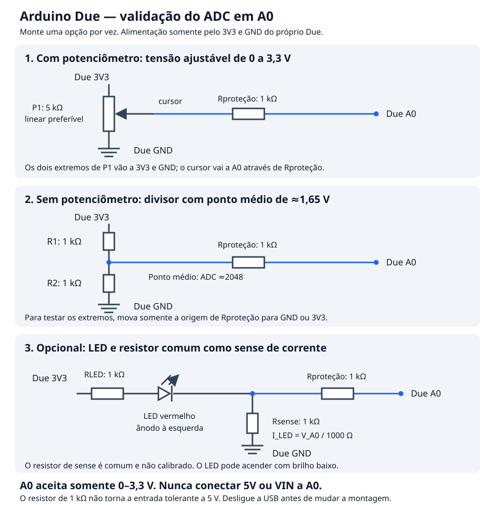

# Primeira versão do firmware: validar o ADC do Arduino Due

O firmware **v0.1.0** está em
[`arduino-due/firmware/firmware.ino`](../arduino-due/firmware/firmware.ino).
Ele lê **A0 em 12 bits**, calcula mínimo, máximo e média de 64 leituras e
envia uma linha de resultados aproximadamente a cada 100 ms pela porta
**Programming**, a **115200 baud**.

Esta etapa valida a leitura de tensão antes de integrar o INA180-181EVM e os
shunts da [proposta do medidor](029_projeto_medicao_corrente_arduino_due.md).
As tensões em volts usam uma referência nominal de 3,3 V e são estimativas;
esta versão ainda não implementa calibração, captura por timer/PDC ou os
modos PROFILE/BURST de alta velocidade.

## 1. O que comprar na loja

| Quantidade | Componente | Observação |
|---:|---|---|
| 5 | Resistores de **1 kΩ**, ¼ W, ±5% ou ±1% | Cada montagem usa até três; os outros ficam de reserva |
| 1 | Potenciômetro de **5 kΩ**, três terminais | Já disponível; preferencialmente linear, geralmente marcado **B5K** |
| 1 ou 2 | LEDs vermelhos comuns de 3 mm ou 5 mm | Vermelho facilita o teste com alimentação de 3,3 V |
| 1 | Protoboard | Uma pequena, de cerca de 400 pontos, é suficiente |
| 10–20 | Jumpers macho–macho | Para ligar Due e protoboard |
| 1, opcional | Capacitor cerâmico **100 nF**, marcado `104` | Pode reduzir ruído na entrada durante os testes lentos |

O potenciômetro é opcional: o divisor com resistores funciona sem ele. Use o
cabo USB de dados que já funcionou. Se tiver um multímetro, use-o para conferir
os resistores, os terminais do potenciômetro e as tensões; ele não precisa ser
um calibrador para estes testes iniciais.

O usuário possui potenciômetros de 5 kΩ e 20 kΩ; não é necessário comprar o
de 10 kΩ inicialmente sugerido. Para este teste, prefira o de **5 kΩ**, cuja
menor impedância de saída facilita a leitura pelo ADC. O de 20 kΩ também pode
ser usado nesta montagem, mas oferece maior impedância. O firmware é o mesmo.

## 2. Cuidados elétricos do Due

As entradas analógicas do Due medem **0 a 3,3 V**. A placa **não tolera 5 V
nessas entradas**; uma sobretensão pode danificar o SAM3X. Alimentar a placa
pela USB é correto, mas o pino **5V** da placa não deve alimentar estes
circuitos de entrada. Use exclusivamente os pinos **3V3 e GND** do Due.
[Especificações oficiais da Arduino](https://store.arduino.cc/products/arduino-due).

Desconecte a USB para montar ou alterar os fios. Não use fonte externa, VIN,
DAC0/DAC1 ou AREF nestes testes. Se usar as linhas de alimentação da
protoboard, confirme que os segmentos escolhidos estão interligados: algumas
protoboards têm essas linhas divididas no meio.

Todas as opções abaixo incluem **Rproteção = 1 kΩ** em série com A0. Ele
limita algumas correntes acidentais, mas **não limita a tensão a 3,3 V** e não
torna o pino tolerante a 5 V. A segurança destes circuitos vem principalmente
da alimentação pelo próprio 3V3 e da montagem correta.

Se usar o capacitor opcional, ligue-o entre **A0 e GND**, depois de
Rproteção e próximo ao Due. Esta opção serve para os testes lentos de tensão;
o filtro do futuro medidor de alta velocidade terá outro dimensionamento.

## 3. Esquema das três opções

Monte **uma opção por vez**. O firmware é o mesmo para todas:



O desenho também está disponível como
[SVG independente](../arduino-due/hardware/adc_test.svg).

## 4. Opção A: com potenciômetro

Para identificar e testar o cursor previamente com uma fonte de 5 V, use o
[guia separado de validação do cursor](../arduino-due/hardware/validacao-cursor-5v.md),
mantendo o Due desconectado. Para o teste do ADC abaixo, use o 3V3 do Due.

```text
Due 3V3 ───── extremo 1 do potenciômetro de 5 kΩ
Due GND ───── extremo 2 do potenciômetro

Cursor do potenciômetro ───── 1 kΩ ───── Due A0
```

Identifique o cursor antes de ligar. Em muitos modelos ele é o terminal
central; confirme a disposição do modelo comprado. Com multímetro e o
potenciômetro desligado, os dois extremos apresentam aproximadamente 5 kΩ
independentemente da posição; a resistência entre cursor e extremo varia ao
girar. Trocar os dois extremos muda somente o sentido do ajuste.

Um potenciômetro linear facilita variar a tensão de maneira aproximadamente
uniforme com o giro. Um logarítmico também funciona para verificar a faixa do
ADC, mas a tensão não varia uniformemente com o ângulo.

Comece na posição central. Reconecte a USB, abra o Monitor Serial e gire
lentamente. As leituras devem subir e descer de forma progressiva, chegando
próximo de 0 e 4095 nos extremos. Não é necessário que cada movimento produza
exatamente o mesmo código: ruído, contatos e tolerâncias influenciam a leitura.

## 5. Opção B: sem potenciômetro

Use três resistores de 1 kΩ:

```text
Due 3V3 ── R1 1 kΩ ──●── R2 1 kΩ ── Due GND
                     │
                     └── Rproteção 1 kΩ ── Due A0
```

O ponto entre R1 e R2 fornece:

```text
V_ponto = V_3V3 × R2 / (R1 + R2)
        ≈ 3,3 × 1 / 2 = 1,65 V
```

Para obter três pontos de verificação, mantenha **Rproteção ligado a A0** e
mova somente sua outra ponta. Desligue a USB antes de cada mudança:

| Origem de Rproteção | Código ADC nominal | Tensão exibida nominal |
|---|---:|---:|
| GND | Próximo de 0 | Próxima de 0 V |
| Ponto entre R1 e R2 | Aproximadamente 2047–2048 | Aproximadamente 1,65 V |
| 3V3 do próprio Due | Próximo de 4095 | Próxima de 3,3 V |

São valores esperados, não resultados já medidos. No ponto médio, resistores
de ±5% podem produzir aproximadamente **1945–2150** contagens somente pela
tolerância da razão, antes de considerar os erros do ADC. Esse desvio não
significa automaticamente um problema na placa.

A leitura no extremo superior pode saturar em 4095. Nunca use 5 V para tentar
"chegar ao máximo". Não deixe A0 desconectado para avaliar precisão: uma
entrada flutuante pode mostrar valores instáveis.

## 6. Opção C: LED e resistor comum como sense de corrente

Esta montagem usa o resistor comum de 1 kΩ como um resistor de sense de
baixa corrente, sem depender de um shunt de precisão:

```text
Due 3V3 ── RLED 1 kΩ ── LED vermelho ──●── Rsense 1 kΩ ── Due GND
                   ânodo → cátodo      │
                                      └── Rproteção 1 kΩ ── Due A0
```

A perna longa do LED normalmente é o ânodo e fica do lado de RLED. O cátodo,
normalmente a perna curta/lado achatado do encapsulamento, fica do lado do
ponto medido e de Rsense. Confira o componente, especialmente se as pernas
já tiverem sido cortadas. LED invertido tende a permanecer apagado e sem
corrente neste circuito; corrija a montagem com a USB desconectada.

O LED pode acender com brilho baixo: a corrente será inferior aos cerca de
1,65 mA obtidos se o LED fosse substituído por um fio. A tensão lida depende
da queda real no LED; **o LED não é uma referência de tensão calibrada**.

Como Rsense está entre o ponto medido e GND:

```text
I_LED ≈ V_A0 / 1000 Ω

Exemplo ilustrativo: V_A0 = 0,70 V → I_LED ≈ 0,70 mA
```

Esse cálculo é aproximado: usa o valor nominal de Rsense e a tensão estimada
do ADC. O firmware exibe tensão, sem aplicar automaticamente essa conversão,
pois ela só faz sentido para esta montagem.

Três verificações possíveis:

1. Com o LED instalado corretamente: aparece uma tensão acima de zero.
2. Com o LED removido: o circuito de corrente abre e Rsense mantém a entrada
   próxima de GND, produzindo leitura próxima de zero.
3. Com o LED substituído por um jumper, **mantendo RLED e Rsense**: a montagem
   volta a ser o divisor com dois resistores iguais e a leitura fica próxima
   de 2048.

Sempre desligue a USB entre essas alterações. Este circuito consome uma
corrente pequena do 3V3 da própria placa; não ligue nele a alimentação de
outra placa BALAS.

## 7. Compilar e gravar a primeira versão

O ambiente de desenvolvimento foi instalado conforme o
[documento 033](033_ambiente-arduino-due-linux.md). Na raiz do BALAS:

```bash
~/.local/bin/arduino-cli compile --fqbn arduino:sam:arduino_due_x_dbg \
  --export-binaries arduino-due/firmware

~/.local/bin/arduino-cli board list

~/.local/bin/arduino-cli upload --fqbn arduino:sam:arduino_due_x_dbg \
  --port /dev/ttyACM0 arduino-due/firmware
```

Confirme a porta antes de gravar; `/dev/ttyACM0` pode mudar. Feche o Monitor
Serial e qualquer diagnóstico Python antes de usar o CLI para gravar. A
gravação substitui o exemplo `due_serial_check` que foi instalado na etapa
anterior.

No IDE, abra `arduino-due/firmware/firmware.ino`, selecione **Arduino Due
(Programming Port)** e também **Ferramentas → Porta → /dev/ttyACM0**, e clique
em Upload. O nome "Programming Port" na escolha da placa não substitui a
seleção da porta do computador.

Depois, abra o Monitor Serial a **115200 baud**. O formato de saída é:

```text
t_ms,adc_min,adc_max,adc_mean,voltage_est_v,batch_us
```

| Campo | Significado |
|---|---|
| `t_ms` | Instante de início do relatório, em ms desde o boot |
| `adc_min`, `adc_max` | Menor e maior códigos no lote de 64 amostras |
| `adc_mean` | Média dos códigos no lote |
| `voltage_est_v` | `adc_mean × 3,3 / 4095`, em volts; não calibrada |
| `batch_us` | Tempo medido para adquirir o lote, sem a impressão serial |

As 64 amostras são consecutivas e bloqueantes. **Dez relatórios por segundo
não significam uma captura contínua a 640 amostras por segundo**: existem
intervalos entre os lotes. Não se trata ainda da aquisição a 500 kS/s prevista
no documento 029. A resolução configurada é de 12 bits, com códigos de 0 a
4095; resolução não implica 12 bits de precisão efetiva.

## 8. Sobre "queimar algumas portas"

O Due expõe **12 entradas analógicas, A0 a A11**. A primeira versão e o canal
analógico da proposta atual usam uma entrada, inicialmente A0.

Não existe uma quantidade garantida de entradas que possam ser danificadas
sem inviabilizar o objetivo. Os pinos pertencem ao mesmo SAM3X; a própria
Arduino informa que aplicar tensão excessiva pode danificar o chip. Um dano
por sobretensão pode afetar mais do que o pino usado, incluindo o ADC ou o
microcontrolador inteiro. Portanto, **um único acidente pode inutilizar a
placa**, e não se pode tratar os outros pinos como onze tentativas de reserva.
[Especificações oficiais da Arduino](https://store.arduino.cc/products/arduino-due).

Se uma falha for diagnosticada como realmente restrita a uma entrada, pode
ser possível usar outra. O firmware permite mudar `ADC_INPUT_PIN` de `A0`
para `A1`, por exemplo, e recompilar. Isso exige também mover o fio da entrada
e verificar os demais canais; a mudança de pino não comprova que uma placa
danificada continua adequada para medição quantitativa.

## 9. Validação realizada nesta etapa

O firmware foi compilado para `arduino:sam:arduino_due_x_dbg`, usando SAM core
1.6.12, com **15.708 bytes** de programa reportados pelo compilador. O binário
exportado fica em
`arduino-due/firmware/build/arduino.sam.arduino_due_x_dbg/firmware.ino.bin`;
os arquivos gerados estão excluídos do Git pelo `.gitignore` do diretório.

**A validação elétrica dos três pontos e das montagens depende da montagem
física.** Nesta etapa foram preparados e compilados o código e os circuitos;
não foram medidos resultados de ADC nessas montagens, nem foi gravada esta
versão sobre o exemplo anterior.

## Referências

- [Arduino Due — especificações e limites elétricos](https://store.arduino.cc/products/arduino-due).
- [Arduino Due — documentação](https://docs.arduino.cc/hardware/due/).
- [Configuração da resolução de leitura](https://docs.arduino.cc/language-reference/en/functions/analog-io/analogReadResolution/).
