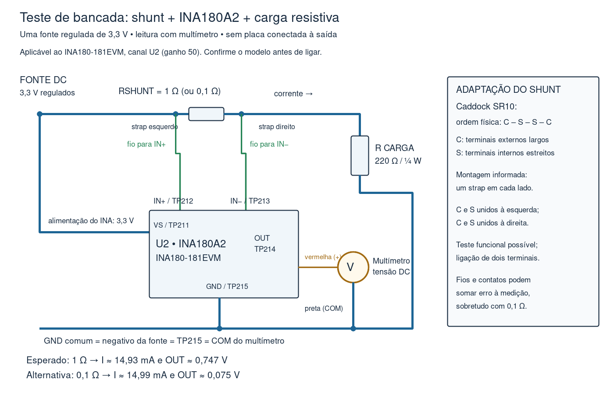

# Teste de bancada do shunt e INA180 com carga resistiva

> Registro de uma proposta anterior. Para continuar o ensaio efetivamente feito
> com o shunt de 0,1 Ω, leia o [checkpoint de 2026-11-03](042_checkpoint_medicao_shunt_2026-11-03.md)
> e use o desenho 041 indicado nele.

Para montar com os quatro terminais separados e entender a diferença para
os straps unidos, use o [guia ilustrado de ligação Kelvin](038_sr10_kelvin_montagem_clara.md).
Este documento 037 descreve a adaptação com um strap por lado já informada.

Esquema para montagem e verificação inicial; ainda não ensaiado fisicamente.
Aplicável ao **INA180-181EVM, canal U2 / INA180A2, ganho 50**, e aos shunts
Caddock SR10 de 1 Ω ou 0,1 Ω previstos no projeto. Confirme as marcações dos
componentes reais antes de usar os nomes dos pontos de teste abaixo.



[Desenho vetorial](imagens/037_teste_resistivo_shunt_ina180.svg).

## Material

- Uma fonte DC regulada de **3,3 V**, independente da placa que será medida.
- Um resistor de carga de **220 Ω, pelo menos ¼ W**, preferencialmente 1%.
- Um shunt de 1 Ω ou 0,1 Ω; use um por vez.
- INA180-181EVM, canal U2.
- Multímetro com medição de tensão DC, fios e protoboard para este teste.

Se a fonte permitir, ajuste o limite de corrente inicialmente para 30 mA.
Não ligue diretamente uma fonte de 5 V mantendo as expectativas desta tabela.
O resistor de carga limita a corrente; o shunt sozinho não serve como carga.

## A adaptação dos quatro terminais

Para o **Caddock SR10**, o desenho mecânico do fabricante identifica a sequência
**C – S – S – C**: os externos, mais largos, conduzem corrente; os internos,
mais estreitos, fazem a medição Kelvin. Cada lado tem um C e um S ligados
internamente ao mesmo lado do elemento resistivo.

Na montagem informada, você soldou **um strap unindo C e S à esquerda e
outro unindo C e S à direita**, formando dois pontos externos de conexão.
Isso não curto-circuita o elemento resistivo entre os lados: ele continua
entre o strap esquerdo e o direito. Os terminais de cada par já pertencem
à mesma região metálica do componente, como mostra o desenho mecânico.

Para o teste inicial, mantenha essa adaptação:

- Strap esquerdo: recebe +3,3 V e também se conecta a IN+.
- Strap direito: alimenta o resistor de carga e também se conecta a IN−.

Assim o INA mede entre os dois pontos adaptados. Conecte os fios de IN+ e
IN− o mais perto possível dos straps no corpo do shunt. Se ambos forem
conectados apenas nas trilhas da protoboard, quedas nos fios adaptadores,
soldas e contatos compartilhados também entram na medição. Esse efeito
é proporcionalmente mais relevante no shunt de 0,1 Ω. A montagem serve
para verificar o funcionamento; não preserva a ligação Kelvin de quatro
terminais usada para especificar a precisão do resistor.

Apoie o corpo do shunt para não forçar as soldas e isole os straps para
não se tocarem. Fios finos podem atender ao teste de aproximadamente 15 mA,
mas a adaptação não foi inspecionada fisicamente e não permite presumir
capacidade para correntes maiores.

O teste de continuidade não distingue os pares com confiança: até o elemento
de 1 Ω ou 0,1 Ω pode fazer o multímetro apitar. Use o desenho mecânico e a
marcação do modelo; não deduza a pinagem apenas pelo apito.

O uso da protoboard aqui é uma montagem temporária de baixa corrente. Para
o medidor definitivo, mantenha a montagem PTH e o caminho de corrente fora
da protoboard conforme o documento 029.

## Ligações

Faça todas as ligações com a fonte desligada.

| Origem | Destino |
| --- | --- |
| +3,3 V da fonte | Strap esquerdo do shunt |
| Strap direito do shunt | Uma ponta do resistor de 220 Ω |
| Outra ponta do resistor de 220 Ω | Negativo da fonte / GND |
| Strap esquerdo do shunt | IN+ (TP212 no canal U2) |
| Strap direito do shunt | IN− (TP213 no canal U2) |
| +3,3 V da fonte | TP211 / VS |
| Negativo da fonte | TP215 / GND |
| TP214 / OUT | Ponta vermelha do multímetro em tensão DC |
| Negativo da fonte | Ponta preta / COM do multímetro |

O GND do INA está no negativo da fonte, **não** no terminal do shunt que segue
para a carga. IN+ e IN− medem somente a queda no shunt. A corrente da carga
não deve atravessar os pontos de teste do EVM.

Use os pontos de teste populados do canal U2. A alimentação do EVM já tem
capacitor de desacoplamento. Se o seu INA for outro módulo ou um CI avulso,
esta identificação TP211–TP215 não se aplica: verifique a pinagem e o
desacoplamento do componente real antes de montar.

## Valores nominais esperados

Para fonte de 3,300 V, carga de 220 Ω e ganho 50:

| Shunt | Corrente na carga | Queda no shunt | Saída do INA |
| --- | ---: | ---: | ---: |
| 1 Ω | 14,93 mA | 14,93 mV | 0,747 V |
| 0,1 Ω | 14,99 mA | 1,499 mV | 0,075 V |

São cálculos nominais, não resultados medidos. A carga dissipa aproximadamente
0,05 W. Comece pelo shunt de **1 Ω**, se disponível: a saída maior facilita
a primeira leitura e reduz a importância relativa do offset.

Equações:

```text
I_carga = V_fonte / (R_carga + R_shunt)
V_shunt = I_carga × R_shunt
V_out ≈ 50 × V_shunt
I_estimado_pelo_INA ≈ V_out / (50 × R_shunt)
```

A resistência dos contatos, tolerâncias e offset alteram os resultados reais.

## Roteiro de verificação

1. Com tudo desligado, confira a identificação dos terminais, as soldas e as
   trilhas internas da protoboard. Meça o resistor de carga isolado, se possível.
2. Confirme 3,3 V na fonte antes de conectá-la. Deixe o resistor de carga instalado
   e ligue o conjunto. Confirme a alimentação entre TP211 e TP215.
3. Meça a tensão sobre o resistor de carga. Divida pelo valor medido de sua
   resistência para obter uma referência de corrente sem usar a escala de ampères.
4. Meça TP214 em relação ao GND e compare com `50 × R_shunt × I_referência`.
   Por exemplo, para shunt de 1 Ω, cerca de 0,75 V corresponde a cerca de 15 mA.
5. Desligue a fonte, desconecte uma ponta da carga e religue. Com os fios de
   sense ainda conectados, a saída deve cair para perto de zero; offset impede
   exigir zero exato. Desligue antes de recolocar a carga.
6. Para um segundo ponto, substitua a carga, com a fonte desligada, por
   **100 Ω / ¼ W**. Se houver limitador, ajuste para 50 mA. Com shunt de 1 Ω,
   espere aproximadamente 32,67 mA e 1,634 V; com 0,1 Ω, 32,97 mA e 0,165 V.
   A carga dissipa aproximadamente 0,11 W.

Mantenha a ponta vermelha no borne de tensão do multímetro. Nunca coloque a
escala de corrente em paralelo com a fonte.

Saída próxima de zero com carga conectada exige conferir IN+/IN−, alimentação,
continuidade dos fios de sense e se a carga realmente recebe corrente.
Saída próxima da alimentação exige conferir o valor do shunt, ganho do canal,
conexões e contatos. Para este circuito, os valores calculados ficam longe
da saturação. Desligue antes de alterar as ligações.

O teste demonstra resposta estática e ajuda a detectar erros de montagem.
Não comprova calibração, largura de banda ou desempenho com cargas pulsadas.

## Referências verificadas

- [TI: manual INA180-181EVM, esquema do canal U2](https://www.ti.com/lit/ug/sbou183/sbou183.pdf).
- [Caddock: Type SR, desenho SR10 e terminais C/S](https://www.caddock.com/online-catalog/mrktg-lit/TypeSR.pdf).
- [Projeto local e montagem definitiva](029_projeto_medicao_corrente_arduino_due.md).
