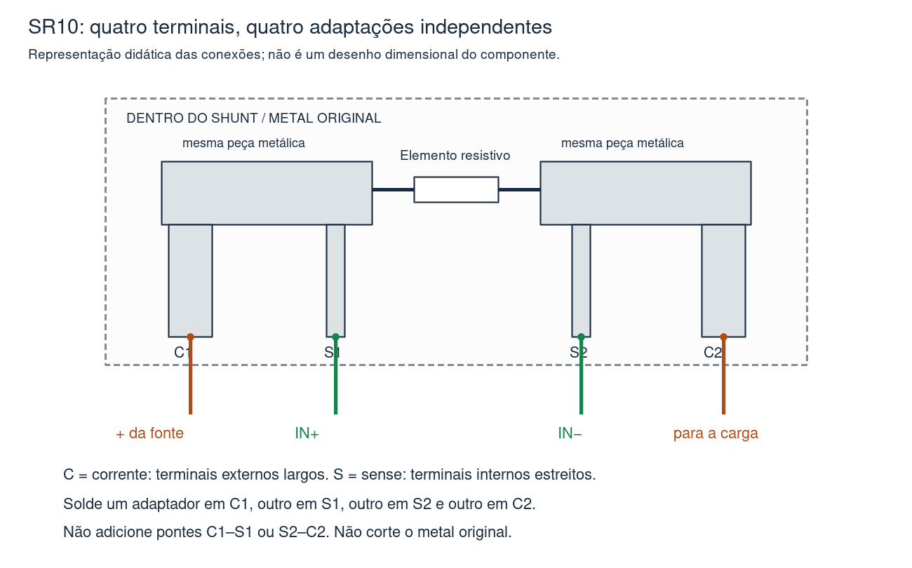
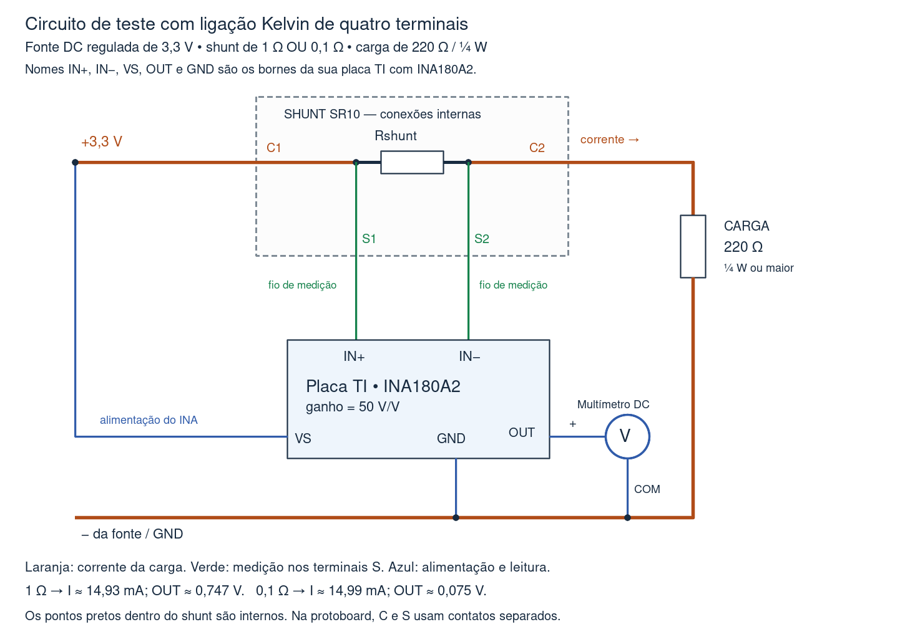

# SR10: terminais, adaptação e circuito de teste Kelvin

> Alternativa didática com quatro conexões; não é a montagem atual do usuário.
> A retomada deve seguir o [checkpoint de 2026-11-03](042_checkpoint_medicao_shunt_2026-11-03.md),
> preservando a adaptação de dois fios sem exigir novas soldas.

Este documento mostra a alternativa com quatro conexões independentes para
os shunts Caddock SR10 de 1 Ω e 0,1 Ω e a placa TI com INA180A2 já montada.
Os desenhos foram conferidos visualmente; não houve ensaio físico.

## Identificação dos terminais



O desenho acima é didático e não reproduz dimensões ou a construção exata
do filme resistivo. C1, S1, S2 e C2 são identificadores deste guia. No
[datasheet original do fabricante](https://www.caddock.com/online-catalog/mrktg-lit/TypeSR.pdf),
veja os desenhos “SR10 PACKAGE DIMENSIONS” e “CIRCUIT BOARD LAYOUT NOTES”,
que identificam a ordem C–S–S–C, os terminais largos de corrente e os
estreitos de medição. Os dois terminais de cada lado derivam da mesma
região metálica do componente; não devem ser cortados ou separados do corpo.

## Por que separar os fios se o metal é o mesmo?

Em um esquema ideal, toda a peça metálica é um mesmo nó com resistência zero.
Na montagem real, metal, fios, soldas e contatos têm resistência finita.
Ao passar corrente, existe uma pequena diferença de tensão ao longo desse
caminho, mesmo entre pontos da mesma peça metálica.

O terminal C conduz a corrente da carga. O terminal S leva a tensão ao INA,
cuja entrada demanda uma corrente muito menor. Separar esses caminhos evita
incluir as quedas dos adaptadores e contatos de corrente na tensão medida.
A precisão especificada pela Caddock pressupõe o uso dos terminais C e S
em uma ligação Kelvin de quatro fios.

Com um fio externo único por lado, usado simultaneamente pela carga e pelo
INA, a resistência compartilhada pode ser somada ao shunt:

```text
V_medido ≈ I × (R_shunt + R_compartilhada)
erro relativo adicional ≈ R_compartilhada / R_shunt
```

Exemplo apenas ilustrativo, não medido na sua adaptação: se os trechos
compartilhados somarem 0,020 Ω, o erro adicional será aproximadamente 20%
com shunt de 0,1 Ω ou 2% com shunt de 1 Ω. Não sabemos a resistência dos
seus straps; portanto não é possível afirmar o tamanho do erro real.
Se o INA captar a tensão diretamente no corpo, antes dos trechos que
conduzem corrente, parte desse erro é evitada. Quatro conexões independentes
nos terminais originais deixam a montagem definida e reproduzível.

## Como adaptar para a protoboard

1. Preserve os quatro terminais originais do SR10.
2. Para a montagem Kelvin, remova somente as pontes externas adicionadas
   entre C e S, se puder fazer isso sem danificar o componente.
3. Solde um fio/pino adaptador exclusivamente no terminal C1 largo.
4. Solde outro exclusivamente em S1 estreito; repita para S2 e C2.
5. Use isolamento e suporte mecânico. Os quatro adaptadores não devem
   encostar entre si fora do componente.
6. Na protoboard, coloque cada adaptador em um grupo elétrico independente.
   Não basta usar furos diferentes: vários furos da mesma fileira são unidos
   internamente. Verifique também interrupções nos barramentos laterais.

Uma junção metálica soldada em cada terminal individual pode ser usada como
adaptador. Uma peça metálica que una C e S e saia por um único pino continua
compartilhando o caminho de corrente e não preserva a conexão Kelvin.
O material metálico do adaptador não substitui a separação dos caminhos.

Para este teste de aproximadamente 15 mA, a protoboard pode ser usada como
montagem temporária. A montagem definitiva do caminho de corrente continua
dependendo da corrente desejada, bitola e qualidade das conexões.

## Circuito completo



O retângulo tracejado delimita o shunt. As junções desenhadas **dentro** dele
representam as conexões internas do componente. Não faça essas junções
novamente na protoboard. A placa TI é representada pelos nomes dos bornes,
sem presumir a posição física desses bornes na placa.

| Conexão | Destino |
| --- | --- |
| C1 externo/largo | +3,3 V da fonte |
| S1 interno/estreito, mesmo lado de C1 | IN+ da placa TI |
| S2 interno/estreito, outro lado | IN− da placa TI |
| C2 externo/largo | Uma ponta do resistor de carga de 220 Ω / ¼ W |
| Outra ponta da carga | Negativo da fonte |
| VS da placa TI | +3,3 V da mesma fonte |
| GND da placa TI | Negativo da fonte |
| OUT da placa TI | Ponta vermelha do multímetro em tensão DC |
| COM do multímetro | Negativo da fonte |

Não ligue IN− ao GND: neste circuito ele fica no lado positivo da carga.
A corrente da carga atravessa C1 e C2, não os bornes IN+ e IN− do INA.

## Primeira medição

Monte com a fonte desligada. Use fonte regulada de 3,3 V; se disponível,
ajuste o limite para 30 mA. Instale um shunt por vez, começando pelo de 1 Ω.
Confirme VS em relação ao GND e depois meça OUT em relação ao mesmo GND.

| Shunt | Corrente nominal na carga | OUT nominal, ganho 50 |
| --- | ---: | ---: |
| 1 Ω | 14,93 mA | 0,747 V |
| 0,1 Ω | 14,99 mA | 0,075 V |

Esses valores são cálculos para 3,300 V e carga de 220 Ω. Tolerâncias,
offset e a tensão real da fonte afetam o resultado. A carga dissipa cerca
de 0,05 W. Para uma referência independente, meça a tensão na carga e
divida pelo valor de resistência medido com ela desligada e isolada.

O teste verifica o funcionamento estático e a montagem; não comprova
calibração ou resposta a cargas pulsadas.

Referência da placa: [manual TI INA180-181EVM](https://www.ti.com/lit/ug/sbou183/sbou183.pdf).
Arquivos editáveis: [terminais](imagens/038_sr10_terminais_separados.svg)
e [circuito](imagens/038_circuito_kelvin_teste.svg).
