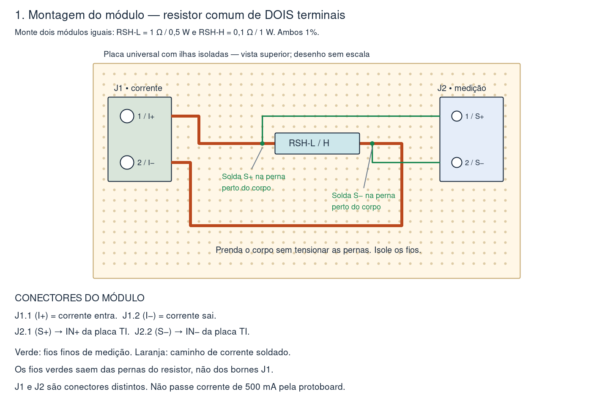
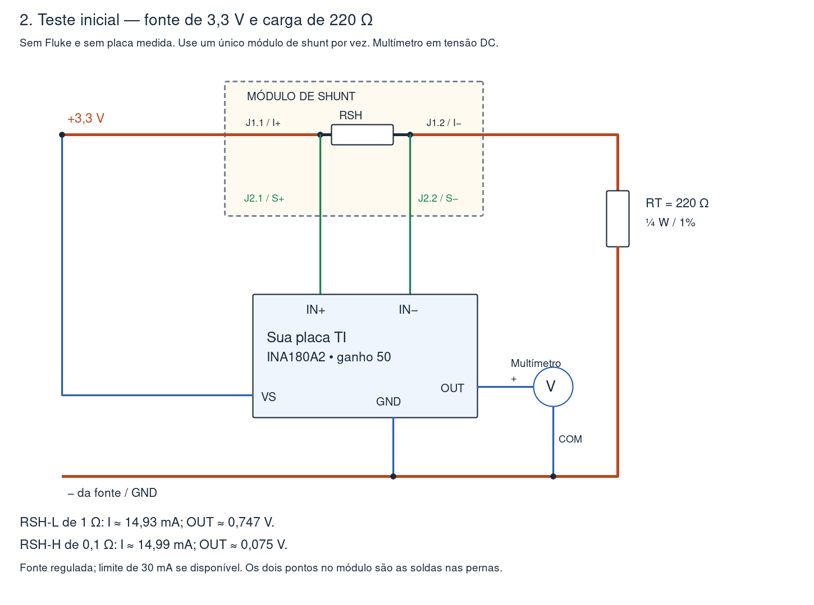
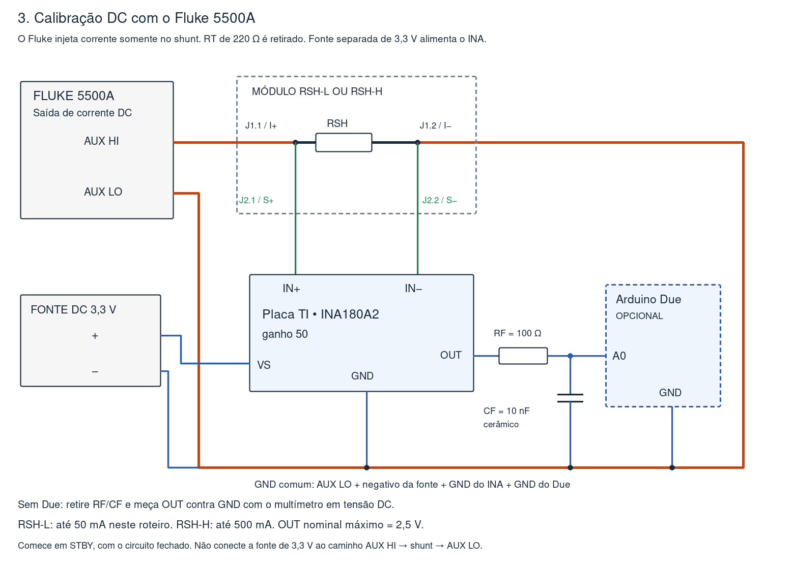
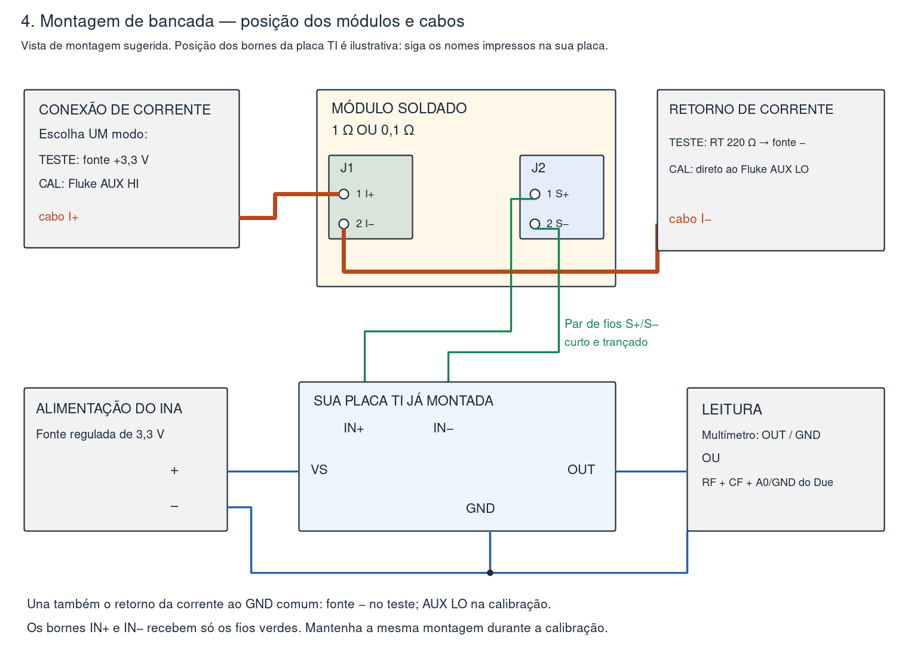

# Circuitos com resistores comuns: montagem, teste e calibração

> Proposta anterior com novos resistores e módulos soldados; não foi montada
> ou validada. O PDF e o ZIP desta pasta preservam essa proposta original.
> Para retomar o trabalho atual com os componentes já disponíveis, leia o
> [checkpoint de 2026-11-03](../042_checkpoint_medicao_shunt_2026-11-03.md).

Projeto para a placa TI já montada com **INA180A2, ganho 50**, usando seus
bornes **IN+, IN−, VS, OUT e GND**. Os novos shunts são resistores íntegros
de **dois terminais**, substituindo a necessidade de adaptar os SR10.

São duas faixas em módulos separados, selecionadas trocando o módulo com
o circuito desligado: **RSH-L = 1 Ω**, até **50 mA** neste roteiro, e
**RSH-H = 0,1 Ω**, até **500 mA**. Nos dois limites, OUT nominal é 2,5 V.
São limites de trabalho adotados aqui para deixar margem na saída com
alimentação de 3,3 V; não são limites de potência dos resistores nem uma
garantia de precisão em toda a faixa.

**Pacote:** [PDF para imprimir](circuitos_e_partlist.pdf),
[partlist CSV](partlist.csv), desenhos PNG e SVG editáveis nesta pasta.
Esquemas e cálculos conferidos; montagem e calibração físicas ainda não executadas.

## Partlist — para construir os dois módulos

| Ref. | Qtd. | Componente e especificação para aquisição | Uso |
| --- | ---: | --- | --- |
| RSH-L | 1 | Resistor axial, 1 Ω, 1%, 0,5 W ou maior, filme metálico de baixa indutância | Faixa até 50 mA |
| RSH-H | 1 | Resistor axial/PTH, 0,1 Ω (R100), 1%, 1 W ou maior, elemento metálico para sense, preferencialmente não indutivo | Faixa até 500 mA |
| RT | 1 | Resistor axial 220 Ω, 1%, ¼ W ou maior | Carga do teste com fonte de tensão |
| RF | 1 | Resistor axial 100 Ω, 1%, ¼ W | Opcional, saída para ADC |
| CF | 1 | Capacitor cerâmico 10 nF, 5% ou melhor, 25 V ou maior; preferir C0G/NP0 | Opcional, filtro junto a A0 |
| J1-L / J1-H | 2 | Borne de parafuso PTH, 2 vias, passo 5,08 mm, especificado para pelo menos 1 A | Corrente: pino 1 I+, pino 2 I− |
| J2-L / J2-H | 2 | Barra de pinos macho 1×2, passo 2,54 mm | Sense: pino 1 S+, pino 2 S− |
| Cabo J2 | 2 | Conector fêmea 1×2 compatível, com dois fios curtos AWG 26; trançar o par | Sense até a placa TI; um por módulo |
| PCB-L / PCB-H | 2 | Placa universal de ilhas isoladas, passo 2,54 mm, cerca de 5×7 cm, ou tamanho adequado aos componentes reais | Suporte soldado dos shunts |
| Fio corrente | 1 m | Cobre isolado AWG 22, dividido entre entrada e retorno | Caminho I+ / I− |
| Fio sense | 1 m | Cobre isolado AWG 26; dois fios por módulo | Solda nas pernas até J2 |
| Isolação | 1 conjunto | Termorretrátil, identificação dos módulos e suporte mecânico | Evitar contatos e esforço nas soldas |
| TI | 1 | Sua placa INA180A2 / INA180-181EVM já montada | Já disponível |
| PS | 1 | Fonte DC regulada de 3,3 V, capaz de fornecer pelo menos 50 mA | Alimentação e teste inicial |
| DMM | 1 | Seu multímetro, em tensão DC | Leitura inicial de OUT |
| Fluke | 1 | Fluke 5500A em fonte de corrente DC, saídas AUX HI e AUX LO | Já disponível para calibração |
| ADC | 1 | Arduino Due, cabo USB e conexões para A0 e GND | Opcional, calibração da cadeia completa |

A lista define valores e características, não afirma disponibilidade em loja.
Para RSH-L e RSH-H, procure TCR especificado de até 100 ppm/°C, preferindo
50 ppm/°C ou menor; se o resistor disponível tiver TCR maior, documente e
verifique a deriva térmica. A calibração corrige o valor inicial, mas não
dispensa verificar estabilidade. A família axial Vishay LVR01 é um exemplo
documentado de resistor de dois terminais com elemento metal strip em
0,1 Ω / 1 W / 1%; confira o TCR e a versão exata no datasheet antes de escolher.

O resistor RSH-L dissipa só 2,5 mW a 50 mA; RSH-H dissipa 25 mW a 500 mA.
As potências da lista deixam margem térmica. Para medir pulsos futuramente,
não presuma que um resistor bobinado genérico tenha resposta adequada.

## 1. Módulo soldado: desenho da montagem



Monte duas unidades, uma com cada valor. Os desenhos são de montagem,
sem escala; não são gabaritos de furação ou posição dos bornes da TI.

1. Coloque J1 e J2 na placa universal e identifique seus pinos.
2. Apoie o resistor sem dobrar as pernas rente ao corpo ou aplicar tração.
3. Solde um fio de sense em cada perna, perto do corpo, respeitando as
   instruções de soldagem do resistor comprado. Leve-os a J2.1 e J2.2.
4. Ligue os trechos externos das pernas a J1.1 e J1.2 com o fio de corrente.
   Os fios de sense devem captar antes dos trechos externos que conduzem corrente.
5. Isole e fixe os fios. Identifique claramente **1 Ω / L** e **0,1 Ω / H**.

Os dois fios por lado se unem na própria perna do resistor, nos pontos verdes
do desenho. Isso exclui da medição a maior parte dos caminhos externos de
corrente, mas não transforma um resistor de dois terminais em um componente
Kelvin interno de quatro terminais. A pequena resistência residual das pernas
entra na calibração e ainda pode variar com temperatura.

Use a protoboard, se necessário, para RT no teste de 15 mA e para sinais.
O caminho de corrente dos módulos fica soldado; os ensaios de 500 mA não
dependem de contatos de protoboard.

## 2. Teste inicial com carga resistiva



| De | Para |
| --- | --- |
| Fonte +3,3 V | J1.1 / I+ do módulo |
| J1.2 / I− | Uma ponta de RT 220 Ω |
| Outra ponta de RT | Fonte − |
| J2.1 / S+ | IN+ da placa TI |
| J2.2 / S− | IN− da placa TI |
| Fonte +3,3 V | VS da placa TI |
| Fonte − | GND da placa TI e COM do multímetro |
| OUT da placa TI | Ponta vermelha no borne V do multímetro |

Monte desligado, instale primeiro o módulo de 1 Ω e ajuste a fonte para
3,3 V, com limite de 30 mA se disponível. Meça VS contra GND e depois OUT
contra GND. Use tensão contínua, não a escala de resistência ou corrente.

| Módulo | Corrente nominal com RT | Queda no shunt | OUT nominal |
| --- | ---: | ---: | ---: |
| 1 Ω | 14,93 mA | 14,93 mV | 0,747 V |
| 0,1 Ω | 14,99 mA | 1,499 mV | 0,075 V |

Esses valores usam fonte de 3,300 V, RT de 220 Ω e ganho 50 ideal. RT dissipa
aproximadamente 0,05 W. Tolerâncias e offset afetam os valores reais.
Troque o módulo somente com a fonte desligada.

## 3. Calibração com o Fluke 5500A



O manual do 5500A identifica **AUX HI / AUX LO** como saídas para corrente.
Use a função **corrente DC**, sem amplificador externo. Neste circuito o
retorno AUX LO fica conectado ao GND do medidor.

| De | Para |
| --- | --- |
| Fluke AUX HI | J1.1 / I+ |
| J1.2 / I− | Fluke AUX LO, diretamente, sem RT |
| J2.1 / S+ | IN+ da placa TI |
| J2.2 / S− | IN− da placa TI |
| Fonte externa +3,3 V | Somente VS da placa TI |
| Fonte externa − | GND da placa TI e AUX LO |
| OUT | Ponta vermelha do multímetro, ou RF para o ADC |
| COM do multímetro | GND comum |

**RT de 220 Ω e a fonte de tensão do caminho de corrente são retirados.**
A fonte externa de 3,3 V continua alimentando o INA por VS/GND. Seu positivo
não se liga a AUX HI, J1 ou ao shunt durante a calibração.

1. Deixe o Fluke em **STBY** e faça as ligações com a fonte do INA desligada.
2. Confira o fechamento do caminho AUX HI → shunt → AUX LO e as polaridades.
3. Alimente o INA com 3,3 V e confirme VS/GND.
4. Selecione corrente DC positiva no Fluke. Comece por 10 mA com módulo L,
   ou 100 mA com módulo H. Só então habilite a saída conforme o manual.
5. Confira OUT antes de prosseguir aos outros pontos. Nesta sequência, não
   exceda 50 mA em L ou 500 mA em H. Pare se houver indicação de compliance
   ou se a saída do INA saturar.
6. Retorne a STBY antes de mudar conexões ou trocar o módulo.

Pontos nominais sugeridos para ajuste:

| RSH-L = 1 Ω | RSH-H = 0,1 Ω | OUT nominal |
| ---: | ---: | ---: |
| 10 mA | 100 mA | 0,5 V |
| 20 mA | 200 mA | 1,0 V |
| 30 mA | 300 mA | 1,5 V |
| 40 mA | 400 mA | 2,0 V |
| 50 mA | 500 mA | 2,5 V |

Faça uma verificação adicional em 15/25/35/45 mA em L ou 150/250/350/450 mA
em H, sem usar esses pontos no ajuste. Para correntes menores, acrescente
pontos próprios e verifique ruído e piso de saída; não extrapole a precisão
dos pontos acima até zero.

As tensões nominais são previsões para verificar a ordem de grandeza,
não valores que devam ser forçados por software. A referência de corrente
é a saída do Fluke, considerando seu estado de calibração e especificações.

## 4. Leitura no Arduino Due e compensação

O Due é opcional para conferir a parte analógica, mas precisa estar conectado
para calibrar a conversão real do ADC. Alimente o Due por sua conexão usual
USB; no desenho, a fonte externa de 3,3 V continua alimentando o INA.
Não una também o pino 3V3 do Due ao positivo dessa fonte externa.

```text
INA OUT ── RF 100 Ω ──+── Due A0
                     |
                   CF 10 nF
                     |
INA GND ─────────────+── Due GND ── GND comum / AUX LO
```

Monte RF/CF junto a A0; CF é cerâmico sem polaridade. Use a mesma alimentação,
configuração do ADC, filtro e montagem na calibração e nas medições seguintes.
Se mudar a alimentação do INA para o Due depois, recalibre nessa configuração.

Registre corrente aplicada, leitura média do ADC, dispersão, módulo e
temperatura/condição térmica. Ajuste separadamente cada módulo:

```text
I_em_ampères = a × código_ADC + b
```

Use os pontos de verificação para calcular os erros residuais. Registre a
leitura a corrente zero separadamente; o piso de saída do INA pode impedir
um ajuste válido exatamente nessa região. Repita pontos após aquecimento e
na sequência decrescente para investigar instabilidade.

O esquema Fluke apresentado testa perto de modo comum zero. No teste com
carga de 220 Ω, o shunt fica perto de +3,3 V. Como o offset do INA depende
também do modo comum, a calibração perto de zero não garante o mesmo offset
em uma aplicação de lado alto. Verifique o conjunto no modo comum da aplicação
antes de declarar a precisão final; uma calibração no modo comum desejado
exige uma configuração adicional do calibrador, não mostrada aqui.

A calibração DC não valida a resposta a pulsos, taxa de aquisição ou largura
de banda. RF/CF seguem o circuito local já proposto; o polo ideal isolado é
aproximadamente 159 kHz, sem constituir medição da banda do sistema.

## 5. Vista de bancada



Laranja identifica o caminho de corrente; verde identifica o par de sense;
azul identifica alimentação e leitura. Cabos que se cruzam na vista de
montagem continuam isolados: só conecte nos terminais identificados.

## Referências verificadas

- [TI INA180: ganho, alimentação, offset e limites de saída](https://www.ti.com/lit/ds/symlink/ina180.pdf).
- [Fluke 5500A: manual, conexão de corrente figura 4-8 e seção 4-23](https://s3.amazonaws.com/download.flukecal.com/pub/literature/5500a___omeng1100.pdf).
- [Vishay LVR: exemplo de construção axial para 0,1 Ω](https://www.vishay.com/docs/30206/lvr.pdf).
- [Projeto local: interface de saída para o Due](../029_projeto_medicao_corrente_arduino_due.md).
